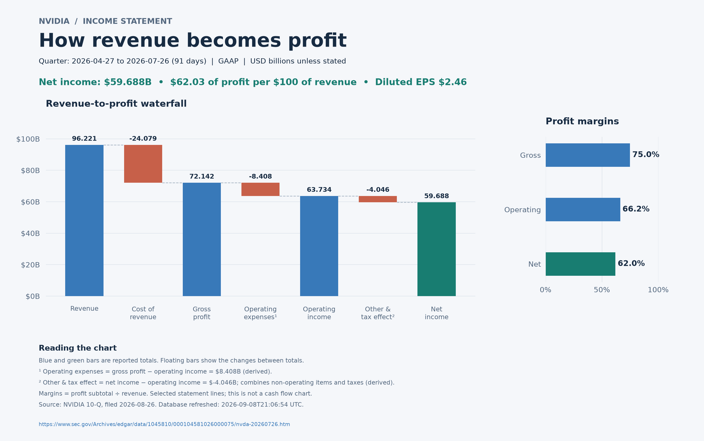

# NVIDIA Earnings Research CLI

**A Python CLI that ingests SEC EDGAR filings into SQLite, answers financial questions deterministically, and uses an LLM only for open-ended analysis, with cited sources.**



**Highlights**
- Discovers the latest 10-Q/10-K and stores every company fact with full provenance: accession, period, taxonomy and units. Refreshes are idempotent.
- Deterministic answers for statements, YoY growth, margins, current ratio and free cash flow. Missing facts are never treated as zero.
- An optional LLM mode (OpenAI Responses API) gets selected metrics and document excerpts, is instructed to cite evidence, and never executes model-generated SQL.
- The core uses only the Python standard library, has throttled and retrying HTTP, and comes with a unit test suite.

**Built with OpenAI Codex**, with Claude Code consulted for review. Stack: Python 3.10+, SQLite, SEC XBRL APIs, matplotlib charts and the OpenAI API.

---

Python 3.10+ command-line app with a local SQLite database. The core app uses only
the Python standard library. Optional OpenAI support answers open-ended questions.

## Run

```bash
export SEC_USER_AGENT='YourApp your-real-email@example.com'
python3 nvda.py refresh
python3 nvda.py ask 'Show the income statement'
python3 nvda.py ask 'What was revenue growth year over year?'
python3 nvda.py ask 'What is the current ratio?'
python3 nvda.py ask 'What is free cash flow?'
python3 nvda.py chat
```

Replace the example email with your real contact address as required by SEC
automated-access guidance. Run `refresh` again to update the database; repeated
imports do not duplicate facts. Requests are throttled and retry transient failures.
The default database is `nvda.sqlite3`; choose another with `--db PATH` before the command.

## Visualize the income statement

```bash
python3 -m venv .venv
source .venv/bin/activate
pip install -r requirements-charts.txt
python3 nvda.py chart
# Optional historical period:
python3 nvda.py chart --report-date 2026-07-26 --output charts
```

Open the generated HTML file in a browser, or use its PNG and SVG exports.
A waterfall explains the changes from revenue to net income; horizontal bars compare
profit margins. Derived operating expenses and the combined other-income/tax effect
are labeled. Matching periods and reconciliation are checked before rendering.
Run `refresh` and then `chart` to update. This command currently charts the income statement.

## Open-ended questions

```bash
python3 -m venv .venv
source .venv/bin/activate
pip install -r requirements-ai.txt
export OPENAI_API_KEY='your-api-key'
export OPENAI_MODEL='your-accessible-responses-model-id'
python3 nvda.py ask --ai 'How do cash generation and net income compare, and what might explain the difference?'
python3 nvda.py chat --ai
```

Select a Responses API model available to your account. `--ai` sends the question,
selected financial metrics from up to eight filings, and relevant document excerpts
to OpenAI and incurs API usage charges. No model-generated SQL is executed. The
model receives dates and source URLs and is instructed to cite evidence and show
calculations. AI interpretation and arithmetic should be checked against its sources.
Each chat question is independent; follow-up questions must repeat their context.

Without `--ai`, supported questions include selected line items, the three statement
summaries, YoY growth, gross/operating/net margins, current ratio, working capital,
and free cash flow. Other questions return matching document excerpts when available.
This mode recognizes supported phrases rather than arbitrary natural language.

## Dates and source coverage

`python3 nvda.py status` lists stored filings, document titles, source URLs, and
refresh timestamps. To select a historical period, use its exact report end:

```bash
python3 nvda.py ask --report-date 2026-07-26 'Show the balance sheet'
```

The app discovers the latest available 10-Q/10-K from SEC submissions and stores
all returned company facts, including filing accession, start/end dates, taxonomy,
units, and original JSON responses. Selected GAAP metrics power statement summaries;
these summaries are **not complete reproductions** of the financial statements.
SEC company facts omit custom-taxonomy and segment disclosures. The latest earnings
release can precede the latest filed statements. Check `status` rather than assuming
the release and statement dates match. The app uses the most recent original filing
for a report date; amendments are stored but not automatically substituted.

Income figures use the reported quarter for a 10-Q and full year for a 10-K.
Balance figures are point-in-time. Cash flows use reported year-to-date/full-year
figures and are labeled accordingly. The app does not derive standalone Q4 income
or Q2–Q4 cash flows. Ratios require matching dates and units. YoY growth uses a
comparable period within the same filing, with an eight-day tolerance for fiscal
calendar differences. Missing facts are never replaced with zero.
Free cash flow is operating cash flow minus capital spending; NVIDIA’s broader
productive-assets tag includes software and intangible assets and is disclosed when
used. Current debt securities are an explicitly labeled fallback for short-term investments.

Earnings releases are discovered from the first four NVIDIA newsroom pages; extend
the search with `refresh --news-pages 12`. Website changes or access failures produce
warnings. A refresh can successfully update SEC data while earnings discovery fails.
Full earnings call transcripts are not guaranteed on NVIDIA's public site, and audio
webcasts are not transcribed. Add an accessible HTML document or a transcript you have:

```bash
python3 nvda.py add-url 'https://nvidianews.nvidia.com/news/your-earnings-release'
python3 nvda.py add-url 'https://your-source.example/transcript' --kind transcript
python3 nvda.py add-text transcript.txt --source 'https://your-source.example/transcript' --title 'NVIDIA earnings call' --published 2026-08-26
```

`add-url` supports HTML, not PDFs or JavaScript-only pages. Imported local text must
be UTF-8. Document retrieval uses keyword-ranked excerpts from up to 20 documents;
it does not guarantee exhaustive transcript or historical coverage.

## Validation and sources

```bash
python3 -m unittest -v
```

- [SEC submissions and XBRL APIs](https://www.sec.gov/search-filings/edgar-application-programming-interfaces)
- [SEC automated access guidance](https://www.sec.gov/about/developer-resources)
- [NVIDIA newsroom](https://nvidianews.nvidia.com/news)
- [NVIDIA quarterly results](https://investor.nvidia.com/financial-info/quarterly-results/default.aspx)
- [OpenAI Responses API quickstart](https://developers.openai.com/api/docs/quickstart)
